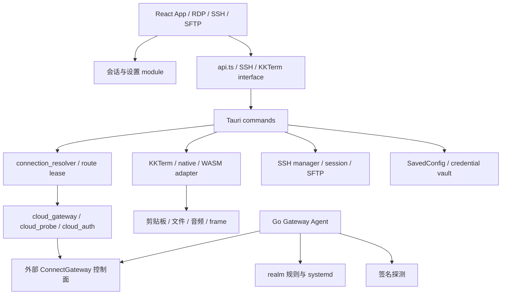

# NextDesk 全仓库架构审查

日期：2026-10-23。基线：`691e908`（v1.0.135）。本轮为本地改进，不代表新版本已发布。

## 范围与完成定义

本轮覆盖仓库自有代码的所有主要领域：frontend/src 下 159 个已跟踪文件、50 个 Rust 源文件、Gateway Agent 的 12 个 Go 文件、8 个脚本和 2 个 CI workflow（基线计数，含现有测试）。以模块职责、依赖、状态所有权和关键链路为单位审查；没有逐行证明整个代码库正确，也没有审计生成的 WASM、第三方依赖内部或仓库外 ConnectGateway 控制面实现。

v1.0.135 已完成的 SSH 输入队列、RDP resize controller、SFTP 目录快照和连接结果所有权继续复用。通过 deletion test 选择改动：收拢真实重复职责、取消错误的共享状态；仅仅移动长文件不会增加 module depth。

## 当前架构

桌面端请求控制面分配、探测并提交线路；Go Agent 从控制面获取任务并维护转发。桌面端不会直接调用本仓库 Agent。此处的客户端 interface 与控制面 seam 不能通过本地单元测试宣称端到端验收。

## 覆盖清单

| 领域 | 阅读和追踪的入口 | 结论与验证层级 |
| --- | --- | --- |
| App、i18n、用户设置 | `App.tsx`、`LanguageProvider.tsx`、`useSessionStore.ts`、SSH settings stores | 启动读取、用户操作、持久化与订阅所有权；行为测试 |
| RDP 工作区与多引擎 | `RdpManager.tsx`、`rdp/`、`useNativeRdp.ts`、KKTerm/native Rust adapters | 保持引擎 seam 和既有 resize/outcomes；映射/生命周期测试，实机另列 |
| SSH / SFTP | `SshWorkspace.tsx`、`TerminalSurface.tsx`、`useSftpDirectory.ts`、`src-tauri/src/ssh/` | 输入、会话、主机密钥、文件操作、监控与清理；保留已集中模块 |
| 前后端 interface | `api.ts`、`ssh-api.ts`、`kkterm/commands.ts`、`lib.rs` handler | AST 盘点 105 个固定 invoke、91 个不同命令，全部在 97 项注册集中；不替代 cfg 平台和参数运行验证 |
| 路由与云授权 | `connection_resolver.rs`、`cloud_gateway.rs`、`cloud_probe.rs`、`cloud_auth.rs` | 状态码在 HTTP adapter 内解释；重试、授权失效、绑定失效使用稳定标记 |
| 配置与凭证 | `config.rs`、`credential_vault.rs`、云授权保存/退出路径 | 配置更新与异步回写归属；旧云凭证验证后迁入系统 vault |
| 文件、剪贴板与渲染 | `file_transfer_ws.rs`、`virtual_file_clipboard.rs`、`cliprdr/`、平台文件提供者、frame/audio | 传输状态、落盘与中断清理；保留平台适配差异 |
| 诊断与反馈 | `logging.rs`、`diagnostic_logs.rs`、`connection_outcome.rs`、前端日志/反馈入口 | 保留脱敏、轮转、隐私选择和路由 lease 归属；现有回归覆盖 |
| Gateway Agent | `cmd/`、`config`、`api`、`runner`、`realm`、`probe` | 启动→poll→执行→ACK，规则隔离、失败处理、输入读取上限；Go 和 race 检查 |
| 依赖、构建、发布 | Cargo manifests/locks、npm manifests、`scripts/`、两个 workflow、`RELEASE.md` | 保留 IronRDP 补丁与构建选择；补 Go gate 和手动构建失败日志隔离 |

## 本轮落实的改进

| 优先级 | module / seam | 改进与行为证据 |
| --- | --- | --- |
| P1 | [Cloud gateway](../src-tauri/src/cloud_gateway.rs) → auth / resolver → UI | HTTP 401/403、429、renew 410、prepare 404 在 adapter 内映射稳定标记，删除分散文本猜测。URL 中出现同样数字不会导致误清授权或错误重试；认证、RDP、SSH 共享限流文案 |
| P1 | [Config transaction](../src-tauri/src/config.rs) / [Cloud auth](../src-tauri/src/cloud_auth.rs) | 所有配置写入经过串行 read-modify-write 和同目录临时文件替换；坏配置拒绝写入，错误返回调用方。授权 revision 区分同一设备再次授权，迟到状态或 401 不得修改新授权；偏好变更不被旧快照覆盖 |
| P1 | [File transfer](../src-tauri/src/file_transfer_ws.rs) | 全局 session map 改为连接所有权；协议 ID 不再作为目录名。私有暂存目录由 transfer transaction 管理，未提交中断自动清理。共享暂存入口在原生 provider 分发前校验文件名，session ID 安全编码，文件使用独占创建；声明长度、chunk 长度、写入失败与重复文件名得到检查 |
| P1 | [Realm rules](../gateway-agent/internal/realm/rules.go) / [Runner](../gateway-agent/internal/runner/runner.go) | 拒绝 `.` / `..` ID；未知 action 不再触发删除。新配置启用成功后提交规则，失败恢复原配置并尝试恢复原实例；删除错误明确返回，损坏记录不阻断健康记录处理 |
| P1 | Agent HTTP / SSH probe interface | HTTP body 消费上限 1 MiB、SSH banner 累计上限 8 KiB；从读取时限制，超限或读取错误返回失败，避免读完整个输入再校验 |
| P2 | [Language](../frontend/src/i18n/LanguageProvider.tsx) / [Shared setting](../frontend/src/lib/useSessionStore.ts) | 用户语言选择优先于迟到系统结果，卸载及 StrictMode 旧请求不能写回；共享文件夹设置用一个 external store 负责写入与通知，连续更新及其他窗口清空存储保持一致 |
| P2 | [Updater](../src-tauri/src/updater.rs) | HTTP 拒绝、缺失或空版本字段明确报错，避免把失败当作“已是最新版”；公开 UpdateInfo interface 保持兼容 |
| P2 | [Release gate](../.github/workflows/build.yml) | Go 1.22 声明版本测试放在 Linux gate，并作为后续质量与打包门槛；手动 Windows 构建失败日志上传 workflow artifact，只有 tag 事件可写 Release |

收益主要是 **locality**（一个职责只有一个状态 / 失败处理入口）和 **leverage**（现有调用方共同受益）。没有新增通用 DI、仓储层或为了拆文件而拆出的浅 module。

## 续作：剩余仓库内事项

| 优先级 | module / interface | 完成情况 |
| --- | --- | --- |
| P1 | SSH session / SFTP / monitor | 输入、输出、resize、远端关闭、显式取消统一退出；session 和 SFTP runtime 拥有 JoinSet。关闭队列、拒绝新工作、取消并等待子任务，保留传输的临时文件清理；替换会话等待旧实例完成 |
| P1 | frame server | accept loop 拥有全部客户端任务，停止监听后取消并等待；空闲 WS close 也能回收。调用方可 await shutdown 完成；测试构建启用独立 transport module，不代表整个实验 native 引擎已实机验收 |
| P1 | Go Agent runner / realm / probe / HTTP | 主 context 贯穿执行链；关停后不接收新任务，回滚有独立预算；--once 等待结果投递，ACK 和结果请求失败明确返回/记录 |
| P1 | [Cloud credentials](../src-tauri/src/cloud_credentials.rs) / Config | 以系统 vault 引用作为新存储，先保存并读回验证新 token，再原子切换配置。提交失败清理新条目且保留旧条目；legacy 数据只在成功后清理。凭证读取校验授权快照，已有引用读失败不回退到旧 token |

术语见 [GLOSSARY.md](../GLOSSARY.md)。本次只实现现有控制面接口的取消、超时、等待和错误反馈；可靠重投需要控制面幂等契约，未创建未经约定的队列。

## 验证记录

| 检查 | 结果 |
| --- | --- |
| Node 20 前端 lint | 0 errors、12 个既有 warnings，仍低于仓库门槛 13 |
| 前端全量测试 | 52 个文件、420 项通过 |
| TypeScript / Vite production build | 通过；保留既有 chunk size 警告 |
| Rust（macOS / kkterm-rdp） | 续作全量 193 项通过；cargo fmt --check 通过。含真实本地 SSH/SFTP 协议、frame WebSocket 和凭证提交失败回归 |
| Gateway Agent | 普通测试、race、Go 1.22.12 external linker 各 95 项通过；普通运行和 --once 的本地实进程 SIGTERM/挂起 HTTP 取消检查通过 |
| 声明 Go 版本限制 | 本机 macOS 对 Go 1.22 默认链接测试程序报 `missing LC_UUID`；不是源代码编译失败。Go CI 使用 Ubuntu，远端工作流本轮尚未执行 |
| 桥接检查 | TypeScript AST 检查 105 处调用 / 91 个命令，无未注册命令；不覆盖所有参数语义与平台 cfg |
| Workflow / diff | YAML 解析和 gate / tag guard 断言通过；最终 git diff --check 通过 |

## 保留的设计及后续验收

- **引擎 adapter 保留。** Windows ActiveX、macOS KKTerm 和 native/WASM 的输入、显示与剪贴板约束不同；复用路由与会话结果职责，不能用一个通用实现掩盖平台差异。
- **更新提示与安装的两条来源保留兼容语义。** GitHub Release 可提供手工安装包，而 Tauri updater 依赖平台项和签名。是否隐藏缺少可安装更新的 Release 是产品行为选择。本轮修复检查失败被当作“无更新”的错误，不取消手工更新兼容性。
- **云凭证迁移已实现，系统验收仍待执行。** 新授权只写系统 vault 的不可变随机引用；旧 macOS CLI 项及 token 文件在读取、写入新 vault、读回验证和配置提交成功后才清理。配置提交失败保留原配置与旧凭证，不再写入明文 fallback。实际 macOS Keychain / Windows Credential Manager 迁移未操作用户账号，仍为 Not Verified。已迁移账号若回退到只认识旧 token 存储的版本，需要重新授权。
- **清理失败与崩溃限制。** 未提交或已退休 vault 条目清理失败会记录警告；旧存储清理失败保留可读的新引用，并在后续读取重试。断电可能留下未引用的受保护 vault 条目；未宣称跨系统断电原子性。realm 回滚遇到实际 systemd/磁盘故障仍会返回错误。客户端无法回滚 OAuth 服务端已经执行的 token 轮换。
- **控制面契约不在本仓库。** Agent 的 ACK/probe-result 重投、幂等和服务端状态收敛须与 ConnectGateway 联合验证；不能仅凭客户端重试推断最终一致性。
- **关停链路已在本仓库闭环。** Agent context 贯通 HTTP、探测和 systemctl；每条命令 10 秒超时、额外 1 秒进程等待，必要回滚使用独立 15 秒预算；--once 等待 probe 结果请求完成。SSH session 等待 SFTP/monitor 子任务和传输清理；frame 关闭同时回收已连接和未完成握手的客户端。SFTP 超过 15 秒强制取消时无法保证失联远端临时文件已删除，明确记录此限制。
- **真实运行仍为 Not Verified。** 本轮未执行真实 RDP/SSH、Finder/Explorer 文件粘贴、Windows IME/DPI/多显示器、安装升级回滚、Linux systemd/realm 与控制面端到端验收。生成 WASM 与外部 IronRDP 补丁未改写。

后续候选必须有可复现问题与调用方证据，再决定是否新增 seam。长文件、文件数和抽象层数本身不作为整改指标。

## 2026-10-24 发布前补充

Gateway Agent 0.4.1 已独立提交；ConnectGateway 0.1.48 位于独立私有仓库。插件的失败 ACK、端口保留、删除确认和取消任务收尾已补齐，并通过旧 Agent 0.4.0 / 新 Agent 0.4.1 的真实进程 HTTP 联调。Agent 普通测试、race 和 Linux Go 1.22 CI 均通过；当前 Go 测试共 98 项。协议仍没有 task revision 和持久化结果队列，不能区分同一绑定两个同时 pending 的回执。

桌面端 v1.0.136 的发布检查与硬件验收分别记录。系统 vault 的实际账号迁移、安装升级回滚、真实 RDP/SSH 客户端及物理 IME/DPI/多显示器仍为 Not Verified。凭证迁移后若回退到只认识旧存储的版本，需要重新授权。
